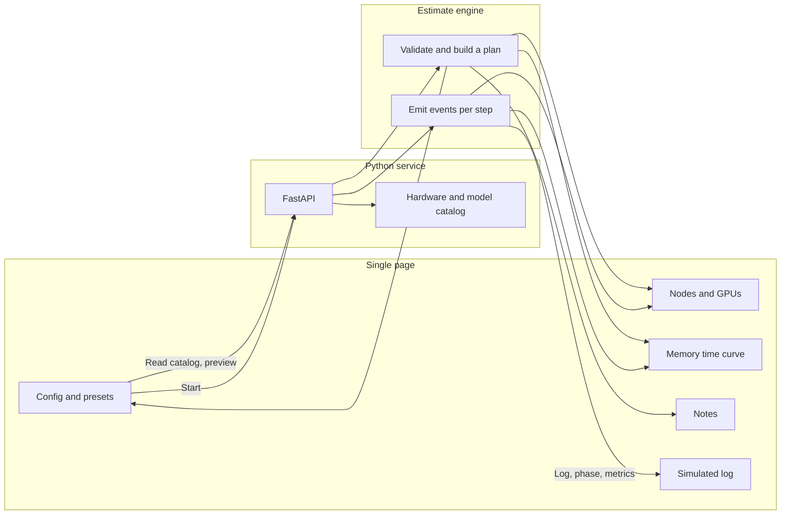

[中文](技术方案.md)

# Technical design for the LLM training simulator

Status: confirmed. This is the basis for the first version.

This document is the implementation contract for version one. It sets the product boundary, the software stack, the training frameworks being simulated, the estimate, and the page structure.

This file is the English translation of [技术方案.md](技术方案.md). The console can show Chinese or English; see the README. The translation follows the confirmed version-one design.

## 1. Background and goal

Many people do not have multi-GPU or multi-node machines, but they still need to understand the things that keep coming up in large-model training: how data is split, who occupies GPU memory, which stages make up one step, why nodes have to communicate, and how those choices change the time.

This project is a **teaching training simulator**. The user picks a cluster, a model, and a training framework on a web page. The simulator uses published order-of-magnitude formulas to produce a memory bill, a step-time breakdown, and a stepped simulated log. From that, the user can compare one GPU, several GPUs on one node, and several nodes under different frameworks.

Success criteria:

- One web page is enough to configure a cluster, start a simulation, and see nodes, the framework, the log, and the metrics.
- Submitting the same configuration again keeps the topology, memory, and step-time estimate the same.
- Six built-in scenarios explain, separately: a single-GPU flow, data parallelism on one node, sharding after one GPU is not enough, multi-node 3D parallelism, a slow network, and running out of memory.
- The page makes it obvious that the current result is an estimate, not the performance of a real job.

## 2. Product scope

Version one includes:

- Three topologies: one GPU, several GPUs on one node, and several GPUs on several nodes.
- Four training frameworks: PyTorch DDP, PyTorch FSDP, DeepSpeed ZeRO, and Megatron-LM.
- Cluster, model, precision, micro-batch, gradient accumulation, sequence length, activation recomputation, learning rate, and step count.
- DeepSpeed ZeRO stage and optimizer CPU offload. Megatron tensor and pipeline parallelism.
- A memory breakdown, compute and communication time, throughput, model FLOPs utilization, and speedup relative to the theoretical single-GPU compute time.
- A simulated log that changes with the framework, and notes that change with the configuration.
- Phase hints during playback: data, forward, backward, gradient sync, optimizer, plus checkpoint and validation.

Version one does not include:

- Real PyTorch, DeepSpeed, or Megatron processes, and no GPU is used for training.
- Accounts, history, multi-user collaboration, or a database.
- Clock-accurate simulation aligned with NCCL or a profiler.
- Inference serving, data cleaning, or tokenizer training.
- LoRA, quantized optimizers, and expert parallelism. Those can be added later. Version one explains the memory and communication of full-parameter training.

## 3. Architecture

The simulator has three parts: the browser page, the HTTP service, and a pure estimate engine. The page does not implement the formulas. The service does not store run results. The engine does not touch a GPU, the network, or a dataset on disk.



One use has two stages.

1. **Preview.** Changing any setting sends the configuration to the service. The service returns a plan: whether it can run, how processes sit on nodes, the memory bill, the time breakdown of one step, and the notes to show. This stage does not produce a per-step log.
2. **Playback.** After the user starts, the service generates launch logs and one event per step from that same plan, and pushes them to the page at a short interval. Playback speed only changes the interval. It does not change the estimate.

The plan is separate from playback so the user can see, before pressing start, whether the configuration exceeds GPU memory and whether communication will dominate compute.

## 4. Stack

The runtime is Python 3.10 on the current machine. Version one uses the set below, so there is no build step and no GPU dependency.

| Layer | Choice | Why |
| --- | --- | --- |
| Language | Python 3.10 | Formulas, checks, and logs fit pure functions that unit tests can call |
| Service | FastAPI + Uvicorn | One process serves the page, the preview, and the stream |
| Validation | Pydantic | Bounds on node count, parallel degrees, and step count |
| Page | Plain HTML, CSS, and JavaScript | No Node build. One command opens it locally |
| Playback channel | NDJSON over HTTP | The browser can read it with `fetch` and abort at any time |
| Chart | Canvas on the page | The loss curve does not depend on a chart library |
| Persistence | None | One simulation is one request. A refresh returns to ready |
| Tests | The standard-library `unittest` module, or a script that can be run directly | Lock the memory and communication conclusions of the presets |

This path was chosen because the product is the estimate and the explanation, not a frontend toolchain or a real distributed runtime. If the page is later replaced by a built frontend, it only has to keep calling the API in section 9. The engine does not need to be rewritten.

The service process hosts the static page and the API together. The default address is `http://<host>:7860`.

Dependencies are managed with uv, declared in `pyproject.toml`, and pinned in `uv.lock`. They stay at:

- `fastapi`
- `uvicorn`

The catalog, the engine, and the page do not import a training framework. `torchrun` and `deepspeed` commands in the log are simulated text, so they can be compared with the launch lines a real project would show.

## 5. What is simulated

### 5.1 Hardware catalog

A GPU record contains at least: memory capacity, BF16 and FP32 peak throughput, memory bandwidth, the intra-node interconnect name and effective bandwidth, intra-node latency, and whether NVLink is present.

Version one includes:

| id | Display name | Memory | Intra-node link |
| --- | --- | --- | --- |
| `rtx4090` | RTX 4090 24GB | 24 GB | PCIe |
| `a100_80` | A100 80GB | 80 GB | NVLink |
| `h100_80` | H100 80GB | 80 GB | NVLink |
| `h20_96` | H20 96GB | 96 GB | NVLink |

Inter-node links:

| id | Display name | Effective bandwidth | Latency |
| --- | --- | --- | --- |
| `eth_10` | 10GbE Ethernet | 1 GB/s | 40 μs |
| `eth_100` | 100GbE Ethernet | 10 GB/s | 15 μs |
| `ib_hdr` | InfiniBand HDR | 20 GB/s | 2 μs |
| `ib_ndr` | InfiniBand NDR | 40 GB/s | 1.5 μs |

Bandwidth is an effective value, already below the theoretical peak of the link, and is meant for teaching scale. A single-node job does not use the inter-node link. The page still keeps the control and says that it is not part of this estimate.

The numbers come from the order of magnitude of public specifications. The catalog is labeled “teaching estimate, not a vendor benchmark.”

### 5.2 Model catalog

Models use teaching approximations. Names are written as a class, such as “7B-class decoder,” not as the exact structure of one release.

| id | Name | Parameters | Layers | hidden | Heads |
| --- | --- | --- | --- | --- | --- |
| `gpt2` | GPT-2 124M | 1.24e8 | 12 | 768 | 12 |
| `d1_5b` | 1.5B-class decoder | 1.5e9 | 28 | 1536 | 12 |
| `d7b` | 7B-class decoder | 6.7e9 | 32 | 4096 | 32 |
| `d13b` | 13B-class decoder | 1.3e10 | 40 | 5120 | 40 |
| `d70b` | 70B-class decoder | 7.0e10 | 80 | 8192 | 64 |

The head count must be divisible by the tensor-parallel degree. The layer count must be divisible by the pipeline-parallel degree.

### 5.3 Four training frameworks

| id | Framework | Parallelism in the simulation |
| --- | --- | --- |
| `ddp` | PyTorch DDP | Data parallelism only. Each GPU stores full parameters, gradients, and optimizer state. One AllReduce of the gradients happens at the end of the step. |
| `fsdp` | PyTorch FSDP | `FULL_SHARD`. Parameters, gradients, and optimizer state are sharded across data-parallel ranks. Every microbatch AllGathers parameters on the forward and the backward, then ReduceScatters gradients at the end of the backward. |
| `deepspeed` | DeepSpeed ZeRO | The ZeRO stage decides what is sharded. Optimizer state can optionally sit on the CPU. |
| `megatron` | Megatron-LM | Tensor, pipeline, and data parallelism exist together. The distributed optimizer is on by default, so optimizer state is sharded again across data-parallel ranks. Inside a tensor-parallel group, sequence parallelism reduces activation at that order of magnitude, and each layer produces collectives. |

ZeRO stages:

| Stage | Parameters | Gradients | Optimizer state |
| --- | --- | --- | --- |
| ZeRO-1 | One copy per GPU | One copy per GPU | Sharded across data parallelism |
| ZeRO-2 | One copy per GPU | Sharded | Sharded |
| ZeRO-3 | Sharded | Sharded | Sharded |

When the framework changes, the page shows only the controls that framework uses. DDP and FSDP do not offer tensor parallelism, pipeline parallelism, or a ZeRO stage. Megatron does not offer a ZeRO stage. CPU offload appears only for DeepSpeed. The server checks again, so a request that bypasses the page cannot submit an invalid combination.

### 5.4 How processes sit on machines

Let the node count be `N` and the GPUs per node be `G`. Then the process count is `world = N * G`.

Megatron uses `tp` and `pp` from the configuration. The other frameworks treat both as 1 in the estimate. The requirement is `world % (tp * pp) == 0`, and the data-parallel degree is `dp = world / (tp * pp)`.

The global rank order is: data parallelism on the outside, pipeline parallelism in the middle, tensor parallelism on the inside. A contiguous run of `tp` ranks is one tensor-parallel group. Nodes take contiguous ranks, and every `G` ranks belong to one machine. Machine addresses are teaching addresses starting at `10.0.0.11`.

That yields `(rank, node, local_gpu, tp_rank, pp_rank, dp_rank)` for every GPU, and the page draws it directly.

If a tensor-parallel group, a pipeline group, or a data-parallel group stays on one machine, communication uses intra-node bandwidth. Otherwise it uses the hierarchical collective in section 6.3. When a tensor-parallel group crosses a node, the plan says so explicitly: intra-layer communication is amplified by the inter-node network. That is a warning that still allows playback, not a configuration error.

## 6. Estimate

The estimate compares configurations and explains where time and memory went. It does not promise to reproduce the loss, tokens/s, or NCCL log of a real training run.

The page and the log use the words “simulation” and “estimate.” The loss curve is a teaching curve that falls with the step count, plus a little noise. It is not the real loss on a dataset.

### 6.1 Memory

Mixed precision (BF16 or FP16) uses 16 bytes per parameter:

- 2 bytes for the parameter
- 2 bytes for the gradient
- 12 bytes on the optimizer side: 4 bytes of FP32 master weight, and 4 bytes each for the first and second Adam moments

FP32 training also uses 16 bytes per parameter: 4 for the parameter, 4 for the gradient, and 8 for the Adam state.

The parameter count owned by this GPU is taken from tensor and pipeline parallelism first. The framework then multiplies parameters, gradients, and optimizer state by their shard fractions. Data parallelism by itself does not reduce the model state on one GPU, unless the framework uses ZeRO, FSDP, or the Megatron distributed optimizer.

Activation memory depends only on the micro-batch, the sequence length, the layers on this stage, and the hidden size. It is not multiplied by the gradient-accumulation steps. Accumulation grows the global batch. One forward still keeps the activation of one micro-batch. The formula:

```text
activation = micro_batch * seq_len * hidden * layers_on_stage * dtype_bytes * k / tp_div
```

- Without activation recomputation, `k = 14`
- With activation recomputation, `k = 2.2`
- Only Megatron sets `tp_div` to the tensor-parallel degree, to show sequence parallelism spreading the activation
- `layers_on_stage = layers / pp`
- Activation bytes are 4 for FP32 and 2 for mixed precision

Another 1.2 GB is added for the CUDA context and allocator overhead.

FSDP and ZeRO-3 temporarily gather the current layer’s parameters while that layer runs. Peak memory adds the unsharded part of that layer on top of the already sharded parameters.

When CPU offload is on, optimizer state is not counted in GPU memory, and the step time gains the PCIe transfer. Effective PCIe bandwidth is 12 GB/s.

If the per-GPU peak exceeds that GPU’s capacity, the preview marks it as not fitting. Playback follows the “allocation failed after launch” log and does not enter training steps. At 92% of capacity the plan explains fragmentation risk and still allows playback.

### 6.2 Compute time

Compute for one token is estimated as `6 * parameter count`. In one optimizer step, each GPU handles `micro_batch * grad_accum * seq_len` tokens. Tensor and pipeline parallelism spread those FLOPs across the GPUs that participate.

Effective throughput = peak throughput × efficiency. Efficiency is 0.28 when the parameter count is below 2 billion, otherwise 0.42. Mixed precision uses the BF16 peak in the record. FP32 uses the FP32 peak.

Pipeline bubble:

```text
bubble = (pp - 1) / (grad_accum + pp - 1)
compute time *= (grad_accum + pp - 1) / grad_accum
```

`grad_accum` is also the microbatch count inside the pipeline. When `pp > 1` and the microbatch count is smaller than the stage count, the notes say the bubble will be large.

### 6.3 Communication time

Collectives use the teaching form of the ring formulas. `P` is the participant count, `B` is the effective bandwidth, and `L` is the latency:

| Operation | Transfer time | Latency term |
| --- | --- | --- |
| AllReduce | `2*(P-1)/P * bytes / B` | `2*(P-1)*L` |
| AllGather, ReduceScatter | `(P-1)/P * bytes / B` | `(P-1)*L` |

When every participant is on one machine, the GPU’s intra-node bandwidth and latency are used.

When participants span several machines, the estimate is a hierarchical collective, and the notes say:

1. ReduceScatter inside the node first.
2. AllReduce the reduced shard across nodes.
3. AllGather inside the node again.

Communication counts in one optimizer step:

| Framework | Communication |
| --- | --- |
| DDP, ZeRO-1, and the data-parallel part of Megatron | One AllReduce of the gradients after accumulation |
| ZeRO-2 | One ReduceScatter after accumulation |
| FSDP, ZeRO-3 | Two AllGathers of parameters per microbatch (forward and backward), then ReduceScatter of the gradients |
| Megatron tensor parallelism | Two AllReduces per microbatch, per layer, on the forward and again on the backward. The message is about `micro_batch * seq * hidden * dtype_bytes` |
| Megatron pipeline | Adjacent stages pass activations. In steady state only part of the point-to-point time is counted as exposed communication. The bubble is already in the compute time |

Overlap of communication and compute:

| Case | Share that compute can hide |
| --- | --- |
| DDP | 0.70 |
| DeepSpeed ZeRO-1 / ZeRO-2 | 0.45 |
| FSDP, ZeRO-3 | 0.30 |
| Megatron | 0.35 |

Exposed communication = `max(0, communication time - overlap × pure compute time)`. Pure compute time does not include the pipeline bubble.

Optimizer time is the parameters, gradients, and optimizer state this GPU must touch, divided by 25% of memory bandwidth. CPU offload adds the PCIe transfer. Data time is a small constant, a little larger for several nodes, and the notes state the assumption that each machine reads a local data shard.

One step:

```text
step = data + compute including the bubble + exposed communication + optimizer
```

Global token throughput = `micro_batch * grad_accum * seq_len * dp / step`.

Model FLOPs utilization is the cluster’s completed `6 * parameter count * global tokens / step`, divided by the sum of peak throughput across all GPUs.

There is also a theoretical speedup versus one GPU: the compute time for the same global tokens on one GPU, divided by the current step time. When one GPU cannot hold the model, the page says this speedup only compares compute and communication.

On several nodes, one step during playback can show a straggler: that step takes longer, and the log says the collective waits for the slowest rank. The planned value in the preview stays stable. That random factor is not written into the preview.

### 6.4 Loss curve

Loss falls exponentially with the step count from about 4.6 to about 1.85, plus a very small Gaussian noise. When there are several nodes and enough steps, one middle step jumps. The note treats the jump as something to observe: learning rate, data, or synchronization can all cause it, and the simulator does not diagnose a real cause.

The learning rate warms up linearly for the first few steps, then uses the configured value. The warmup rule is fixed in the engine. The page shows the learning rate of the current step.

## 7. Simulated log

Every line carries the source prefix `[模拟]` in Chinese, or `[sim]` in English, so it is not mistaken for captured NCCL or framework output.

The launch order is fixed:

1. Print a summary of the node count, GPUs, framework, parallel degrees, and global batch.
2. Print the launch-command shape for that framework, such as `torchrun` or `deepspeed --hostfile`.
3. Each rank joins the process group, with `master_addr`, the port, and `world_size`.
4. Print the intra-node bus and the inter-node network. Several nodes also get teaching environment variables such as `NCCL_SOCKET_IFNAME`.
5. Print the parameter count on this GPU and the memory bill.
6. Print the cautions for this configuration.
7. If memory is not enough, print allocation failure and stop. Otherwise enter the training loop.

The first step expands data, forward, backward, sync, and optimizer. Each later step is one summary line: loss, learning rate, throughput, the step-time parts, and memory.

When the step count is at least 8, a checkpoint is printed halfway: optimizer state is written with the current sharding. The last step prints a validation loss, then the mean step time, throughput, model FLOPs utilization, and speedup for this playback.

Checkpoint time is not a disk simulation of its own. It only appears in the log, to remind the user that what is saved is the sharded state.

## 8. Web page

One page is both the control and the display. At desktop width it is a top bar, config on the left, the cluster in the center, metrics on the right, and the log at the bottom. A narrow window stacks the regions, and each region scrolls on its own.

```text
Top: name, one sentence, status, current step
Left: preset, topology, GPU, inter-node network, framework, parallelism, model, batch, precision, steps, playback speed, start and stop
Center: node cards and every GPU, the current phase, the memory bar, the step-time bar
Right: loss, throughput, model FLOPs utilization, step time, speedup, notes
Bottom: simulated log
```

The statuses are only these: ready, initializing, training, out of memory, finished, stopped, configuration error.

GPU color shows the phase: data, forward, backward, communication, optimizer, checkpoint, failure. The legend stays in the cluster area.

The memory bar stacks parameters, gradients, optimizer, activation, temporary gather, and overhead, and marks this GPU’s capacity. The step-time bar stacks data, compute, exposed communication, and optimizer.

Note cards come from the plan. They are not hard-coded on the page. Typical contents:

- Which part the current framework shards across GPUs.
- Global batch = micro-batch × gradient accumulation × data-parallel degree.
- Activation recomputation trades time for memory.
- When data-parallel gradient sync becomes the main cost.
- Tensor parallelism leaving the node.
- The pipeline bubble.
- Consumer multi-GPU machines using PCIe.
- On several nodes: the master address, matching environments, and data staying local to each node.
- Which memory term is largest, and how sharding, a smaller micro-batch, activation recomputation, and more GPUs each act on a different term.

A preset fills the left column in one step, then previews automatically. Version one has six presets, which are also the acceptance scenarios:

| Preset | What the user should see |
| --- | --- |
| Single-GPU start | A full step of GPT-2 on one 4090 |
| Eight GPUs, data parallel | 8×A100, DDP, 1.5B, gradient sync inside the node |
| Shard when one GPU is not enough | 4×A100, FSDP, 7B, the full model exceeds one GPU |
| Multi-node 3D parallel | 4×8 H100, Megatron, `tp=8` stays inside the node, `pp=2`, 70B |
| A slow network stretches the step | 2 nodes × 2×4090, 10GbE, DDP, exposed communication longer than compute |
| One GPU cannot hold 7B | One 24GB GPU cannot hold the Adam state of a 7B model. Playback ends out of memory |

After start, the config area locks. Stop aborts the read in the browser. The service stops generating when it sees the connection drop. Starting again clears the previous log and curve.

Playback speed can be 1, 2, 4, or 8 times. It only compresses the event interval. The default is 2×, and the default step count lands between 8 and 12, so one demonstration can be watched through.

## 9. API

### `GET /api/catalog`

Returns GPUs, links, models, frameworks, precisions, and presets. The page builds its dropdowns from this. The catalog is the only source on the server. The page does not keep a second copy of the hardware parameters.

### `POST /api/preview`

The body is one training configuration. The response is a plan, containing:

- `errors`: reasons playback cannot start, such as a process count that does not divide, or a head count that is not divisible by the tensor-parallel degree.
- `warnings`: short sentences for something that can still play but needs attention.
- `notes`: note cards, with a title, a body, and a level.
- `cluster`: nodes, addresses, and the rank and parallel coordinates of each GPU.
- `memory`: parameters, gradients, optimizer, activation, temporary gather, overhead, total, capacity, and whether it fits. Unit: GB.
- `parallel`: `world`, `dp`, `tp`, `pp`, and the ZeRO stage.
- `batch`: micro-batch, gradient accumulation, global sample count, global token count.
- `timing`: data, compute, communication, exposed communication, optimizer, step time, bubble fraction, throughput, model FLOPs utilization, theoretical speedup, and whether one GPU would fit. Time unit: milliseconds.
- `formulas`: two or three sentences stating the rules behind this estimate, shown in the page’s estimate notes.

When there are `errors`, the response is still HTTP 200 plus the error list, and the page disables start. The preview API always returns the same shape.

### `POST /api/run`

The body matches the preview. The response is `application/x-ndjson`, one JSON event per line.

| `kind` | Role |
| --- | --- |
| `plan` | The same plan as the preview, sent once when playback starts |
| `log` | `level` is info, warn, or error. `text` is the log line |
| `phase` | `phase` is data, forward, backward, comm, optim, or checkpoint. Optional `bus` describes the current bus |
| `metrics` | Loss, learning rate, throughput, memory, step-time parts, and model FLOPs utilization for the current step |
| `note` | A note that appears during playback, such as a straggler or a loss spike |
| `status` | init, running, oom, done, or error |

When the connection drops, the service stops generating. The service does not create a session id for playback, and it does not write the log to disk.

The server bounds are: nodes 1–32, GPUs per node 1–8, steps 1–300, sequence length 128–8192, micro-batch 1–32, gradient accumulation 1–64. Values outside the range are rejected.

## 10. Code layout

After this document was confirmed, the implementation follows this layout.

```text
LLMTrainerSimulator/
  docs/技术方案.md
  pyproject.toml
  uv.lock
  .python-version
  app/
    catalog.py      # catalog and presets from section 5
    engine.py       # checks, plan, log, and per-step events
    main.py         # FastAPI: page, catalog, preview, run
  static/
    index.html
    styles.css
    app.js
  tests/
    test_plan.py    # assertions for presets and formulas
```

The plan function in `engine.py` stays pure: the same configuration produces the same bill and the same times. It does not read the clock and does not generate a random loss. Random loss and the straggler appear only in the playback generator, seeded from the configuration, so the playback curve of one configuration repeats.

The page module does three things: render the catalog, call preview, and consume NDJSON. The formulas are not written a second time in JavaScript.

## 11. Tests and acceptance

Engine tests do not start a browser. They call the plan function directly.

Conclusions that must stay locked:

- Single-GPU GPT-2, BF16, fits.
- One 4090, DDP, 7B, does not fit even with activation recomputation.
- 4×A100 80GB, FSDP, 7B, activation recomputation, fits.
- When the tensor-parallel degree does not divide the head count, the plan contains an error and must not enter per-step playback.
- The “slow network” preset has exposed communication longer than compute.
- In the “multi-node 3D parallel” preset, the ranks of a tensor-parallel group sit on the same node.
- The global sample count equals `micro_batch * grad_accum * dp`.

Page acceptance walks the six presets by hand:

- The preview’s node count, rank count, and framework name match the left column.
- After start, the log shows the simulation prefix, the launch command, and the memory bill.
- When the phase changes, the GPU color changes with it.
- The out-of-memory preset stops in the failed state and shows the bill.
- After stop, the status becomes stopped and the log stops growing.
- A refresh leaves nothing from the previous run.

The service can be checked with a short-step NDJSON request: the first event is `plan`, a `log` exists, a fitting configuration ends in `done`, and a configuration that does not fit ends in `oom`.

## 12. Phases

**Phase one is the whole scope of this document.** When it is done, the acceptance in section 11 can be completed in a browser.

**Phase two is still a simulator. It does not connect to real training.** It can add a side-by-side comparison of two configurations, lighting pipeline stages on the nodes step by step, and exporting this plan and log as one write-up. Whether to enter phase two is decided after phase one is usable.

**Later than that:** expert parallelism, LoRA, log styles for more frameworks, and a finer hierarchical bandwidth model. None of those change the architecture of “look at the estimate in a browser.”

## 13. Risks

The estimate can be mistaken for a benchmark. The mitigation is that the catalog, the API, and the page all keep the “teaching estimate” label, the log carries the simulation prefix, and the document states that the efficiency factor and the effective bandwidth are settings.

If a formula changes, the notes no longer match the numbers. The mitigation is that the assertions in section 11 cover the qualitative conclusions of the six presets. When a coefficient changes, change the test first, then the note.

If phase one also tried to build a comparison view, accounts, and adapters for real frameworks, the single page would not get finished. This document leaves those outside phase one.

## 14. Decisions that were confirmed

If there is no disagreement with the three items below, the implementation follows the choice in parentheses.

1. Phase one is only the single-page console in section 8. The comparison view waits for phase two. (Suggested: agree)
2. Models use the class approximations in section 5.2. They are not bound to the exact layer configuration of one open-source checkpoint. (Suggested: agree)
3. The software stack is FastAPI plus a plain page, as in section 4. Phase one does not add a frontend build or a database. (Suggested: agree)
