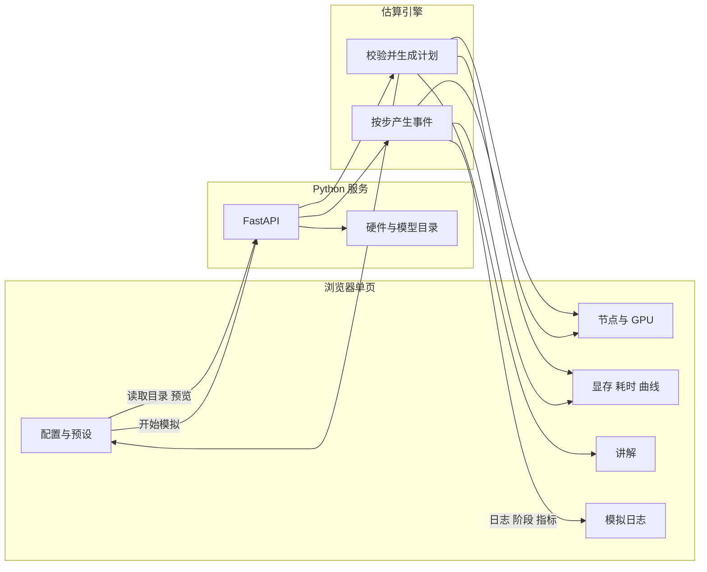

English: [Technical design](technical-design.md).

# 大模型训练模拟器技术方案

状态：已确认，作为第一版实现依据。

本文档是第一版的实现依据。它规定产品边界、软件框架、被模拟的训练框架、估算方法和页面结构。

## 1. 背景与目标

很多人没有多卡或多机资源，仍然需要理解大模型训练里反复出现的事情：数据怎么切、显存被谁占用、一步训练由哪些阶段组成、节点之间为什么要通信、以及这些选择如何改变耗时。

本项目做一台**教学用训练模拟器**。使用者在网页上选定集群、模型和训练框架，模拟器按公开的量级公式给出显存账单、步时拆分和一份带步骤的模拟日志。使用者可以由此观察单卡、单机多卡、多机多卡在不同框架下的差异。

成功标准：

- 打开一个网页就能配集群、启动一次模拟、看到节点、框架、日志和指标。
- 同一套配置重复提交，拓扑、显存和步时估算保持一致。
- 六个内置场景能分别说明：单卡流程、单机数据并行、单卡放不下后的分片、多机三维并行、慢网络、显存不足。
- 页面上能看出当前结果是估算，而不是某次真实任务的性能成绩。

## 2. 产品范围

第一版包含：

- 三种拓扑：一张卡、一个节点上的多张卡、多个节点上的多张卡。
- 四种训练框架：PyTorch DDP、PyTorch FSDP、DeepSpeed ZeRO、Megatron-LM。
- 集群、模型、精度、微批次、梯度累积、序列长度、激活重计算、学习率、步数。
- DeepSpeed 的 ZeRO 阶段和优化器 CPU offload。Megatron 的张量并行与流水线并行。
- 显存分解、计算与通信时间、吞吐、模型 FLOPs 利用率、相对单卡理论耗时的加速比。
- 按框架区分的模拟日志，以及随配置变化的讲解。
- 运行过程中的阶段提示：取数、前向、反向、梯度同步、优化器，以及检查点和验证。

第一版不包含：

- 真实的 PyTorch、DeepSpeed、Megatron 进程，也不占用 GPU 做训练。
- 账号、历史记录、多人协作和数据库。
- 与 NCCL 或某款 profiler 对齐的时钟级仿真。
- 推理服务、数据清洗、分词器训练。
- LoRA、量化优化器和专家并行。这些可以在后续版本加，第一版先把全参训练的显存与通信讲清楚。

## 3. 总体架构

模拟器分成三块：浏览器页面、HTTP 服务、纯计算的估算引擎。页面不自己实现公式。服务不保存运行结果。引擎不访问 GPU、网络和磁盘上的数据集。



一次使用有两个阶段。

1. **预览。** 改任何一个配置，页面把配置交给服务，服务返回计划：能否运行、进程如何排到节点上、显存账单、一步的时间拆分、需要展示的讲解。此阶段不产生逐步日志。
2. **播放。** 使用者启动后，服务按同一次计划生成启动日志和每一步的事件，用很短的间隔推到页面。播放速度只改变推送间隔，不改变估算结果。

计划与播放分离，是为了让使用者在按下开始之前就看到这份配置会不会超出显存、通信会不会压过计算。

## 4. 技术框架与选型

运行环境是当前机器上的 Python 3.10。第一版用下面这一组，避免引入构建步骤和 GPU 依赖。

| 层次 | 选择 | 原因 |
| --- | --- | --- |
| 语言 | Python 3.10 | 公式、校验和日志适合写成可单测的纯函数 |
| 服务 | FastAPI + Uvicorn | 同一进程提供页面、预览和流式播放 |
| 配置校验 | Pydantic | 约束节点数、并行度和步数的取值范围 |
| 页面 | 原生 HTML、CSS、JavaScript | 不需要 Node 构建，一条命令即可在本机打开 |
| 播放通道 | HTTP 上的 NDJSON 流 | 浏览器可用 `fetch` 读取并随时中止 |
| 图 | 页面内 Canvas | 损失曲线不依赖图表库 |
| 持久化 | 无 | 一次模拟等于一次请求，刷新即回到就绪态 |
| 测试 | 标准库 `unittest` 或一个可直接运行的检查脚本 | 锁定预设场景的显存与通信结论 |

选择这条路径，是因为产品的核心是估算和讲解，不是前端工程或真实分布式运行时。页面如果以后要换成带构建的前端，只要继续调用第 10 节的接口即可，引擎不用重写。

服务进程同时托管静态页面和接口。默认地址是 `http://<主机>:7860`。

依赖由 uv 管理，声明在 `pyproject.toml`，锁定版本在 `uv.lock`。只保留：

- `fastapi`
- `uvicorn`

目录、引擎和页面都不导入训练框架。日志里出现的 `torchrun`、`deepspeed` 命令是模拟文本，用于对照真实项目里会看到的启动方式。

## 5. 被模拟的对象

### 5.1 硬件目录

GPU 档案至少包含：显存容量、BF16 与 FP32 的峰值算力、显存带宽、节点内互联名称与有效带宽、节点内时延、是否有 NVLink。

第一版内置：

| id | 展示名 | 显存 | 节点内互联 |
| --- | --- | --- | --- |
| `rtx4090` | RTX 4090 24GB | 24 GB | PCIe |
| `a100_80` | A100 80GB | 80 GB | NVLink |
| `h100_80` | H100 80GB | 80 GB | NVLink |
| `h20_96` | H20 96GB | 96 GB | NVLink |

节点间互联：

| id | 展示名 | 有效带宽 | 时延 |
| --- | --- | --- | --- |
| `eth_10` | 10GbE 以太网 | 1 GB/s | 40 μs |
| `eth_100` | 100GbE 以太网 | 10 GB/s | 15 μs |
| `ib_hdr` | InfiniBand HDR | 20 GB/s | 2 μs |
| `ib_ndr` | InfiniBand NDR | 40 GB/s | 1.5 μs |

带宽取有效值，已经低于链路的理论峰值，用于教学量级。单机任务不使用节点间互联；页面仍保留该选项，并说明它这次不参与估算。

数值来自公开规格的量级，写入目录时注明「教学估算，不是厂商基准」。

### 5.2 模型目录

模型用教学约数，名称写成「7B 级解码器」这种级别，不写成某一发行版的精确结构。

| id | 名称 | 参数量 | 层数 | hidden | 头数 |
| --- | --- | --- | --- | --- | --- |
| `gpt2` | GPT-2 124M | 1.24e8 | 12 | 768 | 12 |
| `d1_5b` | 1.5B 级解码器 | 1.5e9 | 28 | 1536 | 12 |
| `d7b` | 7B 级解码器 | 6.7e9 | 32 | 4096 | 32 |
| `d13b` | 13B 级解码器 | 1.3e10 | 40 | 5120 | 40 |
| `d70b` | 70B 级解码器 | 7.0e10 | 80 | 8192 | 64 |

头数必须能被张量并行度整除，层数必须能被流水线并行度整除。

### 5.3 四种训练框架

| id | 框架 | 模拟中的并行方式 |
| --- | --- | --- |
| `ddp` | PyTorch DDP | 只做数据并行。每张卡保存完整的参数、梯度和优化器状态。一步结束时对梯度做一次 AllReduce。 |
| `fsdp` | PyTorch FSDP | `FULL_SHARD`。参数、梯度、优化器状态沿数据并行切分。每个微批次前向和反向都要 AllGather 参数，反向结束 ReduceScatter 梯度。 |
| `deepspeed` | DeepSpeed ZeRO | 由 ZeRO 阶段决定切分范围。可选把优化器状态放到 CPU。 |
| `megatron` | Megatron-LM | 张量并行、流水线并行、数据并行同时存在。默认打开分布式优化器，优化器状态沿数据并行再切一刀。张量并行组内按序列并行的量级减少激活，并在每层产生集合通信。 |

ZeRO 阶段：

| 阶段 | 参数 | 梯度 | 优化器状态 |
| --- | --- | --- | --- |
| ZeRO-1 | 每卡一份 | 每卡一份 | 按数据并行切分 |
| ZeRO-2 | 每卡一份 | 切分 | 切分 |
| ZeRO-3 | 切分 | 切分 | 切分 |

框架切换时，页面只露出该框架会用到的控件。DDP 与 FSDP 不提供张量并行、流水线并行和 ZeRO 阶段。Megatron 不提供 ZeRO 阶段。CPU offload 只对 DeepSpeed 出现。服务端再校验一次，避免绕过页面提交无效组合。

### 5.4 进程如何排到机器上

设节点数为 `N`，每节点 GPU 数为 `G`，则进程数 `world = N * G`。

Megatron 使用配置里的 `tp`、`pp`。其他框架在估算中把二者当作 1。要求 `world % (tp * pp) == 0`，数据并行度 `dp = world / (tp * pp)`。

全局 rank 的编号顺序是：数据并行最外层，流水线并行在中，张量并行最内层，也就是连续的 `tp` 个 rank 组成一个张量并行组。节点按 rank 连续切分，每 `G` 个 rank 属于一台机器。机器地址使用 `10.0.0.11` 起的教学用地址。

由此可以得到每张卡上的 `(rank, node, local_gpu, tp_rank, pp_rank, dp_rank)`，页面直接画出来。

一个张量并行组、流水线组或数据并行组如果只落在一台机器上，通信走节点内带宽；否则走第 7.3 节的分层集合通信。张量并行组跨出节点时，计划里给出明确讲解：层内通信被节点间网络放大。这是允许运行的警告，不是配置错误。

## 6. 估算模型

估算的目标是比较配置，以及解释时间与显存去了哪里。它不承诺复现某次真实训练的 loss、tokens/s 或 NCCL 日志。

页面和日志使用「模拟」「估算」字样。损失曲线是一条随步数下降的教学曲线，叠加少量噪声；它不代表某个数据集上的真实损失。

### 6.1 显存

混合精度（BF16 或 FP16）按每个参数 16 字节估算：

- 参数 2 字节
- 梯度 2 字节
- 优化器侧 12 字节，其中 FP32 主权重 4 字节，Adam 的一阶矩和二阶矩各 4 字节

FP32 训练按每个参数 16 字节估算：参数 4、梯度 4、Adam 状态 8。

先按张量并行和流水线并行得到本卡负责的参数量，再按框架对参数、梯度、优化器状态分别乘以切分比例。数据并行本身不减少单卡上的模型状态，除非框架做了 ZeRO、FSDP 或 Megatron 分布式优化器。

激活显存只跟微批次、序列长度、本阶段层数和 hidden 有关，不乘梯度累积步数。梯度累积增大的是全局批次，单次前向仍然只留一个微批次的激活。公式：

```text
activation = micro_batch * seq_len * hidden * layers_on_stage * dtype_bytes * k / tp_div
```

- 不做激活重计算时 `k = 14`
- 做激活重计算时 `k = 2.2`
- 只有 Megatron 把 `tp_div` 设为张量并行度，用来表现序列并行把激活摊薄
- `layers_on_stage = layers / pp`
- FP32 的激活字节数为 4，混合精度为 2

另外加 1.2 GB 作为 CUDA 上下文和分配器开销。

FSDP 和 ZeRO-3 在计算当前层时会临时拼回这一层参数。峰值显存要在已切分的参数之外，加上这一层未切分部分。

CPU offload 打开时，优化器状态不计入 GPU 显存，并在步时里加上经 PCIe 搬移的时间，PCIe 有效带宽按 12 GB/s。

单卡峰值超过该 GPU 显存容量时，预览标记为放不下，播放走「启动后分配失败」的日志，不进入训练步。达到容量的 92% 时给出碎片风险讲解，仍然允许播放。

### 6.2 计算时间

训练一个 token 的计算量按 `6 * 参数量` 估算。每张卡在一个优化器步里处理 `micro_batch * grad_accum * seq_len` 个 token，张量并行和流水线并行把这些 FLOPs 摊到参与的卡上。

有效算力 = 峰值算力 × 效率。参数量低于 20 亿时效率取 0.28，否则取 0.42。混合精度使用档案里的 BF16 峰值，FP32 使用 FP32 峰值。

流水线气泡：

```text
bubble = (pp - 1) / (grad_accum + pp - 1)
计算时间 *= (grad_accum + pp - 1) / grad_accum
```

`grad_accum` 在这里同时作为流水线里的微批次数。`pp > 1` 且微批次数小于阶段数时，讲解里说明气泡会很大。

### 6.3 通信时间

集合通信使用 ring 的教学公式。`P` 为参与者数量，`B` 为有效带宽，`L` 为时延：

| 操作 | 传输时间 | 时延项 |
| --- | --- | --- |
| AllReduce | `2*(P-1)/P * bytes / B` | `2*(P-1)*L` |
| AllGather、ReduceScatter | `(P-1)/P * bytes / B` | `(P-1)*L` |

参与者全部在一台机器上时，使用该 GPU 的节点内带宽和时延。

参与者分布在多台机器上时，按分层集合通信估算，并在讲解里写明：

1. 节点内先做 ReduceScatter。
2. 节点间对缩小后的分片做 AllReduce。
3. 节点内再 AllGather。

各框架在一个优化器步中的通信次数：

| 框架 | 通信 |
| --- | --- |
| DDP、ZeRO-1、Megatron 的数据并行部分 | 累积完成后对梯度 AllReduce 一次 |
| ZeRO-2 | 累积完成后 ReduceScatter 一次 |
| FSDP、ZeRO-3 | 每个微批次 AllGather 参数两次（前向、反向），再 ReduceScatter 梯度 |
| Megatron 张量并行 | 每个微批次、每一层、前向和反向各两次 AllReduce，消息大小约为 `micro_batch * seq * hidden * dtype_bytes` |
| Megatron 流水线 | 相邻阶段传递激活。稳态下只把部分点对点时间计入暴露通信，气泡已经体现在计算时间里 |

通信与计算的重叠比例：

| 情况 | 可被计算掩盖的比例 |
| --- | --- |
| DDP | 0.70 |
| DeepSpeed ZeRO-1 / ZeRO-2 | 0.45 |
| FSDP、ZeRO-3 | 0.30 |
| Megatron | 0.35 |

暴露通信 = `max(0, 通信时间 - 重叠比例 * 纯计算时间)`。纯计算时间不含流水线气泡。

优化器时间按本卡要触摸的参数、梯度和优化器状态，除以 25% 的显存带宽来估算。CPU offload 再加 PCIe 搬移时间。取数时间用一个小的固定值，多机时略增，并讲解「每台机器使用本地数据分片」这一前提。

一步时间：

```text
step = 取数 + 含气泡的计算 + 暴露通信 + 优化器
```

全局 token 吞吐 = `micro_batch * grad_accum * seq_len * dp / step`。

模型 FLOPs 利用率 = 集群实际完成的 `6 * 参数量 * 全局 token 数 / step`，除以所有 GPU 的峰值算力之和。

另外给出相对单卡的理论加速比：把同样多的全局 token 交给一张卡时的计算时间，除以当前步时。单卡放不下模型时，页面说明这个加速比只比较算力和通信。

多机时，播放中的某一步可以出现一次慢卡：该步步时提高，日志指出集体操作要等最慢的 rank。预览里的计划值保持稳定，不把这一下随机因素写进预览。

### 6.4 损失曲线

损失从约 4.6 按步数指数下降到约 1.85，并加很小的高斯噪声。多机且步数足够时，中间某一步制造一次损失跳动，讲解里把它当成观察现象的例子：学习率、数据或同步都可能引起跳动，模拟器并不诊断真实原因。

学习率在前若干步线性升温，之后使用配置值。升温规则固定写在引擎里，页面展示当前步的学习率。

## 7. 模拟日志

日志每一行带来源前缀 `[模拟]`，避免被当成真实采集的 NCCL 或框架输出。

启动阶段顺序固定：

1. 用中文摘要打印节点数、GPU、框架、并行度和全局批次。
2. 打印该框架对应的启动命令形态，例如 `torchrun` 或 `deepspeed --hostfile`。
3. 各 rank 加入进程组，写明 `master_addr`、端口、`world_size`。
4. 打印节点内总线和节点间网络。多机时带上教学用的 `NCCL_SOCKET_IFNAME` 一类环境变量。
5. 打印本卡参数量和显存账单。
6. 打印本配置的注意点。
7. 显存不足则打印分配失败并结束。否则进入训练循环。

第一步展开取数、前向、反向、同步、优化器。其后每步一行汇总：损失、学习率、吞吐、步时构成、显存。

步数不少于 8 时，中途打印一次检查点：优化器状态按当前切分方式写出。最后一步打印验证损失，再打印本次的平均步时、吞吐、模型 FLOPs 利用率和加速比。

检查点时间不单独做成磁盘仿真，只在日志里出现，提醒使用者保存的是分片后的状态。

## 8. 网页

一个单页，作为控制端和展示端。桌面宽度下分成顶栏、左配置、中部集群、右侧指标、底部日志。窄屏改为上下排列，各区域自己滚动。

```text
顶栏：名称、一句说明、状态、当前步
左栏：预设、拓扑、GPU、节点间网络、框架、并行、模型、批次、精度、步数、播放速度、开始与停止
中部：节点卡片和每张 GPU、当前阶段、显存构成条、步时构成条
右栏：损失、吞吐、模型 FLOPs 利用率、步时、加速比、讲解
底部：模拟日志
```

状态只有这些：就绪、初始化、训练中、显存不足、已完成、已停止、配置错误。

GPU 用颜色表示阶段：取数、前向、反向、通信、优化器、检查点、失败。图例固定显示在集群区域。

显存条按参数、梯度、优化器、激活、临时拼参、开销堆叠，并标出本卡容量。步时条按取数、计算、暴露通信、优化器堆叠。

讲解卡片来自计划，而不是写死在页面上。典型内容：

- 当前框架把哪一部分切到了多张卡上。
- 全局批次 = 微批次 × 梯度累积 × 数据并行度。
- 激活重计算用时间换显存。
- 数据并行的梯度同步何时成为主要耗时。
- 张量并行跨出节点。
- 流水线气泡。
- 消费级多卡走 PCIe。
- 多机时的主节点地址、环境一致、数据放在各节点本地。
- 显存账单里哪一项最大，以及分片、减小微批次、激活重计算、增加 GPU 分别作用于哪一项。

预设把左栏一次填好，再自动预览。第一版内置六个预设，同时也是验收场景：

| 预设 | 要让使用者看到的事 |
| --- | --- |
| 单卡入门 | 一张 4090 上 GPT-2 的完整一步 |
| 单机八卡数据并行 | 8×A100，DDP，1.5B，节点内梯度同步 |
| 单机放不下就分片 | 4×A100，FSDP，7B，完整模型超出单卡 |
| 多机三维并行 | 4×8 H100，Megatron，`tp=8` 留在节点内，`pp=2`，70B |
| 慢网络拖垮步时 | 2 节点 × 2 张 4090，10GbE，DDP，暴露通信长于计算 |
| 单卡撑爆 7B | 一张 24GB 卡装不下 7B 的 Adam 状态，播放以显存不足结束 |

开始之后配置区锁定，停止会中止浏览器上的读取，服务发现连接断开后停止生成。再次开始会清掉上一轮日志和曲线。

播放速度可选 1、2、4、8 倍，只压缩事件间隔。默认 2 倍，步数默认落在 8 到 12，保证一次演示能看完。

## 9. 接口

### `GET /api/catalog`

返回 GPU、互联、模型、框架、精度和预设。页面用它生成下拉框。目录是服务端的唯一来源，页面不复制一份硬件参数。

### `POST /api/preview`

请求体是一份训练配置。响应是计划，包含：

- `errors`：无法播放的原因，例如进程数不能整除、头数不能被张量并行整除。
- `warnings`：可以播放但需要注意的短句。
- `notes`：讲解卡片，含标题、正文和级别。
- `cluster`：节点、地址、每张 GPU 的 rank 和并行坐标。
- `memory`：参数、梯度、优化器、激活、临时拼参、开销、合计、容量、是否放得下。单位 GB。
- `parallel`：`world`、`dp`、`tp`、`pp`、ZeRO 阶段。
- `batch`：微批次、梯度累积、全局样本数、全局 token 数。
- `timing`：取数、计算、通信、暴露通信、优化器、步时、气泡比例、吞吐、模型 FLOPs 利用率、理论加速比、单卡是否放得下。时间单位毫秒。
- `formulas`：两三句本次估算所依据的规则，显示在页面的估算说明里。

有 `errors` 时返回 200 和错误列表，页面禁用开始按钮。这样预览接口始终返回同一结构。

### `POST /api/run`

请求体与预览相同。响应是 `application/x-ndjson`，一行一个 JSON 事件。

| `kind` | 作用 |
| --- | --- |
| `plan` | 与预览相同的计划，播放开始时先发一次 |
| `log` | `level` 为 info、warn 或 error，`text` 为日志行 |
| `phase` | `phase` 为 data、forward、backward、comm、optim、checkpoint，可选 `bus` 描述当前总线 |
| `metrics` | 当前步的损失、学习率、吞吐、显存、步时构成、模型 FLOPs 利用率 |
| `note` | 播放中新出现的讲解，例如慢卡或损失跳动 |
| `status` | init、running、oom、done、error |

连接断开后服务结束生成。服务不为播放创建会话标识，也不把日志写入磁盘。

取值范围在服务端限制：节点 1–32，每节点 GPU 1–8，步数 1–300，序列长度 128–8192，微批次 1–32，梯度累积 1–64。超出范围直接拒绝。

## 10. 代码结构

确认本文档之后按下面的结构实现。

```text
LLMTrainerSimulator/
  docs/技术方案.md
  pyproject.toml
  uv.lock
  .python-version
  app/
    catalog.py      # 第 5 节的目录与预设
    engine.py       # 校验、计划、日志与逐步事件
    main.py         # FastAPI：页面、catalog、preview、run
  static/
    index.html
    styles.css
    app.js
  tests/
    test_plan.py    # 预设与公式断言
```

`engine.py` 里的计划函数保持纯函数：相同配置得到相同账单和时间，不读取时钟，不生成随机损失。随机损失和慢卡只出现在播放生成器里，并用配置内容做种子，保证同一配置的播放曲线可重复。

页面模块只做三件事：渲染目录、调用预览、消费 NDJSON。公式不在 JavaScript 里再写一遍。

## 11. 测试与验收

引擎测试不启动浏览器，直接调用计划函数。

必须锁定的结论：

- 单卡 GPT-2、BF16，放得下。
- 单卡 4090、DDP、7B、即使用激活重计算，也放不下。
- 4×A100 80GB、FSDP、7B、激活重计算，放得下。
- 张量并行度不能整除头数时，计划含错误且不应进入逐步播放。
- 「慢网络」预设的暴露通信时间长于计算时间。
- 「多机三维并行」预设里，张量并行组的 rank 落在同一个节点。
- 全局样本数等于 `micro_batch * grad_accum * dp`。

页面验收用手走一遍六个预设：

- 预览的节点数、rank 数和框架名称与左栏一致。
- 开始后日志出现 `[模拟]`、启动命令和显存账单。
- 阶段变化时 GPU 颜色跟着变化。
- 显存不足的预设停在失败状态，并给出账单讲解。
- 停止后状态变为已停止，日志不再增长。
- 刷新页面后没有上一轮残留。

服务可用一个短步数的 NDJSON 请求做接口检查：首行为 `plan`，存在 `log`，正常配置的末尾状态为 `done`，放不下的配置为 `oom`。

## 12. 分期

**第一期，就是本文档的全部范围。** 做完后应能在浏览器里完成第 11 节的验收。

**第二期，仍是模拟器，不接入真实训练。** 可以加两份配置并排对比、流水线阶段在节点上的逐步点亮、把本次计划和日志导出成一份说明。是否进入第二期，等第一期可用后再定。

**再往后才考虑的内容：** 专家并行、LoRA、更多框架的日志风格、更细的分层带宽。这些都不改变「浏览器里看估算」这一架构。

## 13. 风险

估算被当成跑分。缓解方式是目录、接口和页面都保留「教学估算」的说明，日志带 `[模拟]` 前缀，文档写明效率系数和有效带宽是设定值。

公式一改，讲解就和数字对不上。缓解方式是第 11 节的断言覆盖六个预设的定性结论；改系数时先改测试再改讲解。

第一期如果同时做对比视图、账号和真实框架适配，单页会做不完。本文档把它们留在第一期之外。

## 14. 请确认的决定

下面三条如果没有不同意见，实现时就按括号里的选择执行。

1. 第一期只做第 8 节的单页控制台，对比视图放到第二期。（建议：同意）
2. 模型使用第 5.2 节的级别约数，不绑定某个开源权重的精确层配置。（建议：同意）
3. 软件框架使用第 4 节的 FastAPI 加原生页面，第一期不引入前端构建和数据库。（建议：同意）
